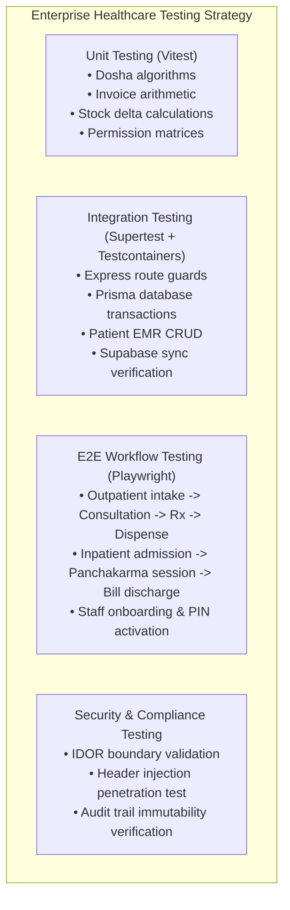

# Sahachara OS 2.0 — Comprehensive Engineering Audit & Discovery Report
## Document 09: Testing & Quality Assurance Audit

---

### 1. Existing Test Coverage Inventory

A comprehensive inspection of the repository confirmed the following automated test coverage:

| Test Layer | Test Runner / Framework | Number of Test Files | Test Cases Count | Code Coverage % | Status |
| :--- | :--- | :---: | :---: | :---: | :---: |
| **Unit Tests** | None (No Jest, Vitest, Mocha) | 0 | 0 | 0% | **NON-EXISTENT** |
| **Integration Tests** | None | 0 | 0 | 0% | **NON-EXISTENT** |
| **API Endpoint Tests** | None (No Supertest, Newman) | 0 | 0 | 0% | **NON-EXISTENT** |
| **Database Tests** | None (No Prisma test harness) | 0 | 0 | 0% | **NON-EXISTENT** |
| **Component Tests** | None (No React Testing Library) | 0 | 0 | 0% | **NON-EXISTENT** |
| **End-to-End Tests** | None (No Playwright, Cypress) | 0 | 0 | 0% | **NON-EXISTENT** |
| **Auth / Security Tests**| None | 0 | 0 | 0% | **NON-EXISTENT** |

There is no `"test"` script defined in `package.json`. No `.test.ts`, `.test.tsx`, `.spec.ts`, or `.spec.tsx` files exist anywhere in the repository.

---

### 2. Execution of Non-Destructive Quality Checks

In strict accordance with Rule 10 ("Never claim something has been tested unless you actually executed the relevant test") and Rule 3 ("DO NOT install, upgrade, downgrade, or remove dependencies"), non-destructive validation checks were executed using the terminal environment:

#### 2.1 Execution Record 1: TypeScript Lint Check (`npm run lint`)
- **Command Executed**: `npm run lint`
- **Working Directory**: `/Users/highflyer/Desktop/Sahachara_Ops`
- **Timestamp**: `2026-11-12T15:54:42+05:30`
- **Result**: **FAILED (Exit Code 127)**
- **Raw Command Output**:
  ```
  > react-example@0.0.0 lint
  > tsc --noEmit

  sh: tsc: command not found
  ```
- **Root Cause Analysis**: The local `node_modules/` folder is not installed in the workspace. Because Rule 3 strictly forbids modifying the environment or running `npm install`, TypeScript compiler binaries (`tsc`) are not available in the local execution path.

#### 2.2 Execution Record 2: Tooling & Package Manager Probe
- **Command Executed**: `which bun; which npm; which npx; which node; ls -la node_modules`
- **Result**:
  ```
  bun not found
  /opt/homebrew/opt/node@22/bin/npm
  /opt/homebrew/opt/node@22/bin/npx
  /opt/homebrew/opt/node@22/bin/node
  ls: node_modules: No such file or directory
  ```
- **Findings**:
  1. Node.js v22 and NPM/NPX are available at `/opt/homebrew/opt/node@22/bin/`.
  2. `bun` is **not installed on the host system**, despite the presence of `bun.lock` in the repository root.
  3. `node_modules` does not exist on disk. No build, bundling, or typechecking commands can be executed without installing dependencies.

---

### 3. Code Quality & Static Analysis Deficits

#### 3.1 Pervasive Use of `any` Type Casts
Across core operational services and views, TypeScript's type safety is frequently bypassed using `any` or non-null assertions:
- `src/services/hospitalApi.ts`: In `inMemoryStore: Record<string, any>`, `as any` is used 18 times to coerce patient insurance, vitals, and signature payloads.
- `server/routes.ts`: `apiRouter.use(authenticateContext as any)` strips Express request typing.
- `server/prismaService.ts`: `data: updates as any` circumvents Prisma type verification.
- `server/supabaseServer.ts`: Function signatures use `patient: any` and `consultation: any`, eliminating compile-time schema checking.

#### 3.2 Global Error Suppression in `index.html` (L4–29)
In `index.html`, an inline IIFE explicitly intercepts and suppresses unhandled exceptions:
```html
<script>
  (function() {
    function shouldSuppress(val) {
      if (!val) return false;
      var str = typeof val === 'string' ? val : (val.message || val.stack || String(val));
      str = str.toLowerCase();
      return str.indexOf('websocket') !== -1 || str.indexOf('vite') !== -1 || str.indexOf('closed without opened') !== -1;
    }
    window.addEventListener('unhandledrejection', function (e) {
      if (e && shouldSuppress(e.reason)) { e.preventDefault(); if (e.stopImmediatePropagation) e.stopImmediatePropagation(); return false; }
    }, true);
    window.addEventListener('error', function (e) {
      if (e && shouldSuppress(e.message)) { e.preventDefault(); if (e.stopImmediatePropagation) e.stopImmediatePropagation(); return false; }
    }, true);
  })();
</script>
```
- **Deficit**: Intercepting and killing unhandled rejections prevents critical WebSocket connection errors and telemetry failures from appearing in browser consoles, making production debugging and error tracking nearly impossible.

#### 3.3 Dead & Duplicate Components
- `src/components/modals/NewStaffModal.tsx` (366 lines) is an obsolete duplicate of `NewStaffMemberModal.tsx` that remains in the codebase as dead code.

---

### 4. Recommended Testing Architecture for Remediation

To elevate Sahachara OS 2.0 to enterprise healthcare quality, the following testing harness must be introduced:



