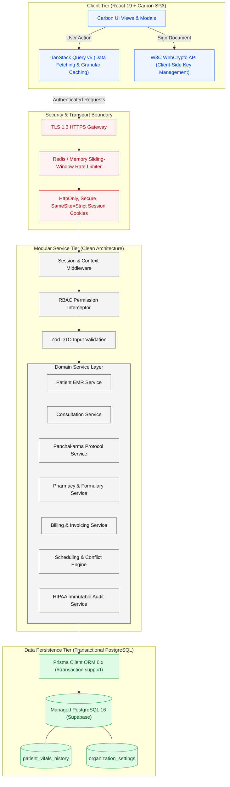

# Sahachara OS 2.0 — Comprehensive Engineering Audit & Discovery Report
## Document 12: Target Production Architecture Blueprint

---

### 1. Target Architectural Vision

The target architecture for **Sahachara OS 2.0** transitions the platform from an in-memory prototype into an enterprise-grade, regulation-compliant Healthcare Information System (HIS). The design emphasizes **strict data persistence, clean separation of concerns, cryptographic authenticity, and granular role-based security**, while preserving the excellent IBM Carbon Design System user interface.



---

### 2. Technology Stack Alignment & Standardizations

| Layer / Capability | Current Implementation | Target Standard | Architectural Justification |
| :--- | :--- | :--- | :--- |
| **Frontend Framework** | React 19 + Vite 8 SPA | React 19 + Vite 8 SPA (Retained) | The current SPA shell is clean, performant, and well-structured. |
| **Data Fetching & Cache**| `hospitalApi.ts` custom cache | **TanStack Query v5** (`@tanstack/react-query`) | Replaces global over-rendering subscription; supports query keys and pagination. |
| **Backend Framework** | Express 4.21 (procedural router) | **Express 4.21 / 5.x** with Clean Architecture | Organizes code into Controllers, Services, and Repositories. |
| **Input Validation** | None (Raw payload assignment) | **Zod v3** schema validation | Strictly validates payloads on all endpoints before reaching services. |
| **Database ORM** | Prisma 6.4 (Used only for 2 models)| **Prisma ORM 6.x** across all 14 models | Full transactional persistence, explicit relations, and migrations. |
| **Database Engine** | Hybrid in-memory / Supabase stub | **PostgreSQL 16 on Supabase** | High-performance managed relational engine with automated backups. |
| **Session & Auth** | Untrusted headers (`x-user-role`) | **Signed JWT / HttpOnly Cookie** | Prevents client privilege escalation; extracts role server-side. |
| **Digital Signatures** | Character-code arithmetic loop | **W3C WebCrypto API (ECDSA P-256)** | True legally compliant digital signatures with public-key verification. |
| **Testing Harness** | None (0 tests) | **Vitest + Supertest + Playwright** | Unit tests for domain logic; integration tests for APIs; E2E for workflows. |

---

### 3. Clean Layered Architecture Structure

The backend source code will be reorganized into a standard Clean Architecture directory hierarchy:

```
server/
├── config/                  # Validated environment configuration (Zod)
├── middleware/
│   ├── authContext.ts       # Validates session tokens and populates req.user
│   ├── rbacGuard.ts         # Validates user permissions against route requirements
│   ├── rateLimiter.ts       # Sliding window rate limiting
│   └── errorHandler.ts      # Standardized JSON error response handler
├── modules/
│   ├── patients/
│   │   ├── patient.controller.ts
│   │   ├── patient.service.ts
│   │   ├── patient.repository.ts
│   │   └── patient.dto.ts   # Zod request/response validation schemas
│   ├── consultations/
│   ├── panchakarma/
│   ├── pharmacy/
│   ├── appointments/
│   └── billing/
└── prisma/
    ├── schema.prisma        # Complete relational schema with explicit relations
    └── migrations/          # Version-controlled database migrations
```

---

### 4. Database Schema Unification & Missing Tables

To resolve schema divergence and data loss, two critical missing tables must be introduced:

#### 4.1 Missing Table 1: `PatientVitalsHistory`
Replaces the synthetic vitals generator with authentic longitudinal records:
```prisma
model PatientVitalsHistory {
  id          String   @id @default(uuid())
  patientId   String
  patient     Patient  @relation(fields: [patientId], references: [id], onDelete: Cascade)
  bpSystolic  Int
  bpDiastolic Int
  heartRate   Int
  spo2        Int
  temperature Float
  respRate    Int
  recordedAt  DateTime @default(now())
  recordedBy  String   // Staff name or ID
  location    String?  // e.g. "Therapy Suite 01", "OPD Room 104"
  notes       String?

  @@index([patientId, recordedAt(sort: Desc)])
  @@map("patient_vitals_history")
}
```

#### 4.2 Missing Table 2: `OrganizationSettings`
Provides persistent storage for hospital identity and configuration:
```prisma
model OrganizationSettings {
  id              String   @id @default("primary")
  facilityName    String   @default("Sahachara Ayurveda Yoga Ecoliving")
  code            String   @default("SAH")
  phone           String   @default("+91 486 422 3400")
  email           String   @default("administration@sahachara.com")
  address         String   @default("Mannamkala Road, Munnar Hills")
  city            String   @default("Adimali")
  state           String   @default("Kerala")
  postalCode      String   @default("685561")
  country         String   @default("India")
  patientPrefix   String   @default("SAH-")
  invoicePrefix   String   @default("SAH-INV-")
  receiptPrefix   String   @default("SAH-REC-")
  updatedAt       DateTime @updatedAt

  @@map("organization_settings")
}
```

---

### 5. True Cryptographic PKI Digital Signature Specification

To replace the simulated pseudo-hash loop, the system will implement true asymmetric cryptography:

1. **Key Generation**: When a clinician is onboarded with signing authority, an **ECDSA (P-256 Curve) key pair** is generated using the browser's `window.crypto.subtle` API.
2. **Key Storage**:
   - The **Private Key** is stored in non-extractable client IndexedDB protected by the clinician's PIN or WebAuthn biometric prompt.
   - The **Public Key** is uploaded to the backend and stored in `staff_members.public_key_pem`.
3. **Signing Workflow**:
   - On prescription or lab approval, the client computes the SHA-256 digest of the canonical document payload.
   - The private key signs the digest, generating a DER-encoded ECDSA signature string.
4. **Server Verification**:
   - The backend retrieves the physician's public key from the database.
   - Using Node.js native `crypto.verify()`, the server cryptographically validates the signature against the document payload before persisting the status as `'verified'`.

